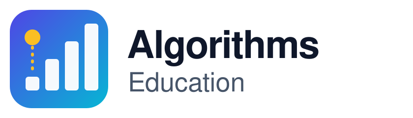

<picture>
  <source media="(prefers-color-scheme: dark)" srcset="media/logo-dark.svg">
  
</picture>

# Awesome Algorithms Education 

> A curated list of courses, online judges, visualizations, books and competitions for learning and practicing algorithms.

Every entry is free to read or use unless marked as paid, and Korean-language resources are tagged so that both English and Korean learners can find what fits them. For implementations and contest-specific material, see [Awesome Competitive Programming](https://github.com/lnishan/awesome-competitive-programming#readme) and [Awesome Algorithms](https://github.com/tayllan/awesome-algorithms#readme).

If you want to contribute, please read the [contribution guidelines](contributing.md).

**English** | [한국어](README.ko.md)

## Contents
- [Courses](#courses)
- [Competitive programming](#competitive-programming)
- [Visualizations](#visualizations)
- [Interviews](#interviews)
- [Videos](#videos)
- [Books](#books)
- [Articles](#articles)
- [Competitions](#competitions)
- [Miscellaneous](#miscellaneous)

## Courses
#### Introductory
- [Algorithms](https://www.khanacademy.org/computing/computer-science/algorithms) - Khan Academy.
- [DSA Tutorial](https://www.geeksforgeeks.org/dsa/dsa-tutorial-learn-data-structures-and-algorithms/) - Geeks for Geeks.
- [Hello Algo](https://www.hello-algo.com/en/) - Open-source, animated introduction to data structures and algorithms with code in many languages.
- [Algorithm course for smart programming](https://www.inflearn.com/course/%EC%95%8C%EA%B3%A0%EB%A6%AC%EC%A6%98-%EA%B0%95%EC%A2%8C) - Korean / Inflearn.

#### Intermediate
- [Algorithms and Data Structures](https://www.classcentral.com/subject/algorithms-and-data-structures) - Class Central.
- [Algorithms](https://www.edx.org/learn/algorithms/iitbombay-algorithms) - edX(IITBombay).
- [Intro to Algorithms](https://www.udacity.com/course/intro-to-algorithms--cs215) - Udacity.
- [Introduction to Algorithms, 2020](https://ocw.mit.edu/courses/6-006-introduction-to-algorithms-spring-2020/) - MIT OCW.
- [Design and Analysis of Algorithms, 2015](https://ocw.mit.edu/courses/6-046j-design-and-analysis-of-algorithms-spring-2015/) - MIT OCW.
- [Introduction to Algorithms, 2011](https://ocw.mit.edu/courses/6-006-introduction-to-algorithms-fall-2011/) - MIT OCW.
- [Classes and Teaching by Erik Demaine](https://erikdemaine.org/classes/) - MIT(Lecture notes).
- [Efficient Algorithms and Intractable Problems, 2001](https://people.eecs.berkeley.edu/~jrs/170/) - UC Berkeley(Lecture notes).
- [Data Structures, 2014](https://people.eecs.berkeley.edu/~jrs/61b/) - UC Berkeley(Lecture notes).
- [Algorithms, Part I](https://www.coursera.org/learn/algorithms-part1) - Coursera(Princeton University).
- [Algorithms, Part II](https://www.coursera.org/learn/algorithms-part2) - Coursera(Princeton University).
- [USACO Guide](https://usaco.guide) - Free structured curriculum for competitive programming, from Bronze to Platinum.

#### Advanced
- [Data Structures and Algorithms](https://pll.harvard.edu/course/data-structures-and-algorithms) - Paid Content. / Harvard University.
- [Algorithms Specialization](https://www.coursera.org/specializations/algorithms) - Paid Content. / Coursera(Stanford University).

## Competitive programming
- [HackerRank](https://www.hackerrank.com/domains/algorithms) - Algorithm practice track with problems grouped by topic, from warmup to dynamic programming.
- [Codility](https://app.codility.com/programmers) - Free lessons with practice tasks on time complexity, prefix sums, sorting and more.
- [TopCoder](https://www.topcoder.com) - Long-running Single Round Matches (SRMs) with a problem archive and editorials.
- [CodeWars](https://www.codewars.com) - Community-made kata for practicing in over 55 programming languages.
- [CodeChef](https://www.codechef.com) - Practice problems and regular rated contests.
- [Codeforces](https://codeforces.com) - English, Russian.
- [AtCoder](https://atcoder.jp) - English, Japanese.
- [UVa Online Judge](https://onlinejudge.org) - Classic problem archive with the uHunt progress tracker and the ICPC Live Archive.
- [A2 Online Judge](https://a2oj.netlify.app) - Archived mirror of the original a2oj.com ladders.
- [ICPC Problem Archive](https://icpc.kattis.com) - Kattis.
- [CS Academy](https://csacademy.com) - English, Russian, Arabic.
- [CSES Problem Set](https://cses.fi/problemset/) - Problem collection grouped by topic, from introductory problems to advanced techniques.
- [CoderByte](https://coderbyte.com) - Coding challenges with video solutions; now primarily a candidate assessment platform.
- [HackerEarth](https://www.hackerearth.com) - Practice section for basic programming, data structures, algorithms and math, alongside hiring assessments.
- [Infoarena](https://www.infoarena.ro) - Romanian.
- [Kattis](https://open.kattis.com) - Problem archive with thousands of problems and difficulty scores.
- [Learneroo Algorithms Tutorials](https://www.learneroo.com/subjects/8) - Tutorials that teach algorithms and data structures by solving challenges.
- [LeetCode](https://leetcode.com/problemset/) - English, Chinese.
- [Rosalind](https://rosalind.info/problems/locations/) - Bioinformatics and programming problems, starting with a Python Village for beginners.
- [ShareCode](https://sharecode.io) - Archived, read-only online judge with problems from past contests.
- [Snakify](https://snakify.org) - Python 3 course for beginners with over 100 exercises.
- [Sphere Online Judge (SPOJ)](https://www.spoj.com) - Large archive of classical problems with support for many programming languages.
- [beecrowd](https://judge.beecrowd.com) - English, Spanish, Brazilian Portuguese. Formerly URI Online Judge.
- [PKU JudgeOnline](http://poj.org) - English, Chinese.
- [AIZU ONLINE JUDGE](https://onlinejudge.u-aizu.ac.jp) - English, Japanese.
- [Project Euler](https://projecteuler.net) - Mathematical problems that need both insight and programming to solve.
- [Advent of Code](https://adventofcode.com) - Annual December puzzle calendar with a new problem each day.
- [Project Euler @kr](https://euler.synap.co.kr) - Korean / Translation of the Project Euler problems.
- [Baekjoon](https://www.acmicpc.net) - Korean / The most widely used Korean online judge.
- [solved.ac](https://solved.ac) - Korean / Difficulty tiers and problem recommendations for Baekjoon.
- [Algospot](https://algospot.com) - Korean / Online judge and community run by the author of Algorithmic Problem Solving Strategies.
- [JUNGOL](https://jungol.co.kr) - Korean / Online judge for Korea Olympiad in Informatics preparation.
- [Koistudy](https://koistudy.net) - Korean / Online judge with problem sets sorted by algorithm and tier, plus contests.
- [CodeUp](https://codeup.kr) - Korean / Online judge aimed at programming beginners.
- [Codingdojang](https://codingdojang.com) - Korean / Problem-solving practice site for sharpening coding skills.
- [Programmers](https://school.programmers.co.kr/learn/challenges) - Korean / Coding test practice problems for job preparation.
- [Codeground](https://www.codeground.org) - English, Korean.
- [SW Expert Academy](https://swexpertacademy.com) - Korean / Samsung's learning platform with problems and courses for software skills.

## Visualizations
- [Algorithm Visualizer](https://github.com/algorithm-visualizer/algorithm-visualizer) - Interactive platform that visualizes algorithms from code.
- [A Visual Guide to Graph Traversal Algorithms](https://workshape.github.io/visual-graph-algorithms/) - Interactive DFS and BFS explanations by Workshape.io.
- [VisuAlgo](https://visualgo.net) - English, Korean, Chinese, Japanese.
- [Algorithms Visualization](https://bost.ocks.org/mike/algorithms/) - Mike Bostock's essay on visualizing sampling, shuffling, sorting and maze generation.
- [Data Structure Visualizations](https://www.cs.usfca.edu/~galles/visualization/Algorithms.html) - Interactive animations by David Galles, University of San Francisco.
- [Sorting Algorithms Animations](https://www.toptal.com/developers/sorting-algorithms) - Side-by-side animations comparing sorting algorithms, hosted by Toptal.
- [Path Finding](https://qiao.github.io/PathFinding.js/visual/) - Interactive grid demo of A*, Dijkstra, BFS, Jump Point Search and other pathfinding algorithms.
- [Introduction to the A* Algorithm](https://www.redblobgames.com/pathfinding/a-star/introduction.html) - Red Blob Games.
- [Python Tutor](https://pythontutor.com) - Step-by-step visual execution of Python, JavaScript, C, C++ and Java code.
- [Algorithm Wiki by Will Thimbleby](https://thimbleby.net/algorithms/) - Interactive wiki whose visualisations run from real JavaScript implementations.
- [TensorFlow Playground](http://playground.tensorflow.org) - Browser demo for tinkering with a small neural network.
- [Tangle](https://github.com/enjalot/algovis) - JavaScript Programming Language.
- [Vamonos](http://rosulek.github.io/vamonos) - JavaScript Programming Language.
- [The Sound of Sorting](https://panthema.net/2013/sound-of-sorting/) - C ++ Programming Language.

## Interviews
- [Interview Cake](https://www.interviewcake.com) - Practice programming interview questions with worked solutions.
- [InterviewBit](https://www.interviewbit.com) - Practice coding interview questions organised by topic.
- [NeetCode](https://neetcode.io) - Curated problem roadmap with video explanations.
- [Software Engineering technical interviews](https://github.com/kdn251/interviews) - Study guide covering data structures, algorithms, runtime analysis, video lectures and interview books.
- [Tech Interview Handbook](https://www.techinterviewhandbook.org) - Free curated interview preparation materials, including the Blind 75 and Grind 75 question lists.
- [Coding Interview University](https://github.com/jwasham/coding-interview-university) - Multi-month computer science study plan for becoming a software engineer.
- [Interactive Python coding interview challenges](https://github.com/donnemartin/interactive-coding-challenges) - Over 120 algorithm and data structure challenges in Jupyter notebooks, with solutions and Anki flashcards.

## Videos
- [How algorithms shape our world](https://www.ted.com/talks/kevin_slavin_how_algorithms_shape_our_world) - Kevin Slavin.
- [Algorithms](https://www.youtube.com/playlist?list=PLDN4rrl48XKpZkf03iYFl-O29szjTrs_O) - Abdul Bari.
- [Algorithms](https://www.youtube.com/playlist?list=PL01A89F4E9E5F3ADE) - Oresoft LWC.
- [Computer Sc - Programming and Data Structure](https://www.youtube.com/playlist?list=PLD9781AC5EBC9FA16) - Nptelhrd.
- [Introduction to Algorithms, 2020](https://www.youtube.com/playlist?list=PLUl4u3cNGP63EdVPNLG3ToM6LaEUuStEY) - MIT 6.006.
- [Design and Analysis of Algorithms, 2015](https://www.youtube.com/playlist?list=PLUl4u3cNGP6317WaSNfmCvGym2ucw3oGp) - MIT 6.046J.
- [Introduction to Algorithms, 2011](https://www.youtube.com/playlist?list=PLUl4u3cNGP61Oq3tWYp6V_F-5jb5L2iHb) - MIT 6.006.
- [Merge Sort vs Quick Sort](https://youtu.be/es2T6KY45cA) - Animated comparison by udiprod.
- [15 Sorting Algorithms in 6 Minutes](https://youtu.be/kPRA0W1kECg)
- [AlgoRythmics](https://www.youtube.com/user/AlgoRythmics/videos) - Sapientia University.

## Books
- [Elementary Algorithms](https://github.com/liuxinyu95/AlgoXY) - Free book of functional algorithms and data structures with 120 exercises, in English and Chinese.
- [Data Structures and Algorithms](https://people.mpi-inf.mpg.de/~mehlhorn/Toolbox.html) - The Basic Toolbox by Mehlhorn and Sanders, with chapter PDFs available for download.
- [Algorithms by Jeff Erickson](https://jeffe.cs.illinois.edu/teaching/algorithms/) - Free textbook and lecture notes from the University of Illinois.
- [Competitive Programmer's Handbook](https://cses.fi/book/book.pdf) - Free / Antti Laaksonen.
- [Open Data Structures](https://opendatastructures.org) - Free.
- [Hello Algo](https://github.com/krahets/hello-algo) - Free / English, Chinese, Japanese and more.
- [CRACKING the CODING INTERVIEW](https://www.crackingthecodinginterview.com) - [GitHub](https://github.com/careercup/CtCI-6th-Edition), [Quora](https://www.quora.com/profile/Gayle-Laakmann-McDowell).
- [Algorithm Design](https://www.pearson.com/en-us/subject-catalog/p/Kleinberg-Algorithm-Design/P200000003259) - Textbook by Jon Kleinberg and Éva Tardos, published by Pearson.
- [Algorithms](https://algs4.cs.princeton.edu/home/) - Fourth edition by Robert Sedgewick and Kevin Wayne, with the book site's code and exercises.
- [Introduction to Algorithms](https://mitpress.mit.edu/9780262046305/introduction-to-algorithms/) - Fourth edition of the CLRS textbook by Cormen, Leiserson, Rivest and Stein.
- [Grokking Algorithms](https://www.manning.com/books/grokking-algorithms) - Illustrated, beginner-friendly guide by Aditya Bhargava, published by Manning.
- [Algorithmic Problem Solving Strategies](https://book.algospot.com) - Korean / Textbook by Jongman Koo that teaches algorithm design through contest problems.

## Articles
- [Algorithms for Competitive Programming](https://cp-algorithms.com) - English translation of the e-maxx algorithm articles.
- [Big-O Cheat Sheet](https://www.bigocheatsheet.com) - Time and space complexities of common data structure operations and sorting algorithms, by Eric Rowell.
- [stoimen's web log](http://www.stoimen.com/category/algorithms) - Blog series on classic algorithms and data structures.
- [What are the best and efficient ways to learn algorithms for beginners?](https://www.quora.com/What-are-the-best-and-efficient-ways-to-learn-algorithms-for-beginners) - Quora.
- [What are the best books on algorithms and data structures?](https://www.quora.com/What-are-the-best-books-on-algorithms-and-data-structures) - Quora.
- [Study data for algorithm](https://d2.naver.com/news/4850628) - Korean / Algorithm study notes from the NEXTERS club, published on NAVER D2.

## Competitions
- [ICPC](https://icpc.global) - The International Collegiate Programming Contest, the oldest and largest team programming competition for university students.
- [IOI](https://ioinformatics.org) - The International Olympiad in Informatics, the annual algorithmic competition for secondary school students.
- [Meta Hacker Cup](https://www.facebook.com/codingcompetitions/hacker-cup) - Meta's annual open programming competition.
- [AtCoder Contests](https://atcoder.jp/contests/) - Weekly rated contests for beginners to experts.
- [Codeforces Contests](https://codeforces.com/contests) - Frequent rated rounds, the most active contest platform.
- [Google Coding Competitions Archive](https://github.com/google/coding-competitions-archive) - Official archive of problems and solutions from Code Jam, Kick Start and Hash Code, which ended in 2023.
- [Google Summer of Code](https://summerofcode.withgoogle.com) - A global program focused on introducing students to open source software development. Students work on a 3 month programming project with an open source organization during their break from university.
- [KOI](https://koi.or.kr) - Korean / Korea Olympiad in Informatics.
- [UCPC](https://ucpc.me) - Korean / Union of Collegiate Programming Contest clubs.

## Miscellaneous
- [The Algorithms](https://github.com/TheAlgorithms) - Open-source implementations of algorithms in every major language.
- [MIT OpenCourseWare](https://www.youtube.com/user/MIT/playlists) - YouTube playlists of full MIT course lectures.
- [Awesome Data Science](https://github.com/academic/awesome-datascience) - Curated list of data science learning resources.
- [Awesome Machine Learning](https://github.com/josephmisiti/awesome-machine-learning) - Curated list of machine learning frameworks, libraries and software by language.
- [Rosetta Code](https://rosettacode.org/wiki/Rosetta_Code) - The idea is to present solutions to the same task in as many different languages as possible, to demonstrate how languages are similar and different, and to aid a person with a grounding in one approach to a problem in learning another.
- [Code.org](https://code.org) - Anybody can learn.
- [CheckiO](https://checkio.org) - Online game for Python and JavaScript coders.
- [HUST Online Judge System](https://github.com/hustoj/hustoj-neo) - Online Judge is a web application.
- [Tech stack for Baekjoon online judge](https://startlink.blog/2015/12/21/boj%EB%8A%94-%EC%96%B4%EB%96%BB%EA%B2%8C-%EB%A7%8C%EB%93%A4%EC%96%B4%EC%A1%8C%EC%9D%84%EA%B9%8C/) - Korean / How to choose a technology stack for judge?
